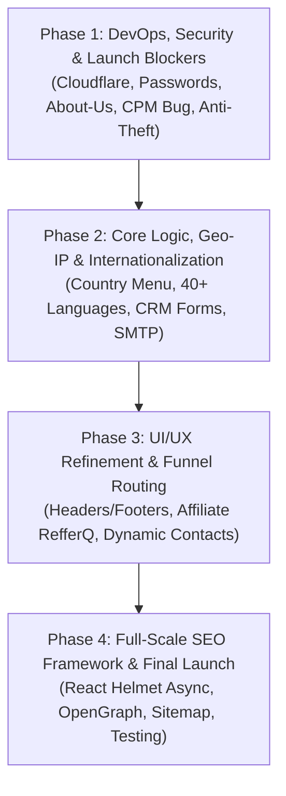

# 🚀 Work Plan: Rule 7 Media Platform Overhaul & Launch Readiness
**Target Project:** Rule 7 Media (`https://www.rule7media.com`)  
**Client:** Kevin  
**Lead Developer:** Sohel  
**Status:** Active Execution  

---

## 📋 Executive Overview
This Work Plan outlines the systematic, phased resolution of all 35+ items identified in the **Consolidated Rule 7 Media Client Queries** and the newly requested **Content & Anti-Scraping Protection**. The delivery is structured into 4 logical phases to allow progressive verification and **GREEN** replies inside the client's tracking document.

---

## 🗺️ Phase-by-Phase Roadmap

---

## 🛡️ PHASE 1: DevOps, Infrastructure & Immediate Launch Blockers
*Priority: Critical | Estimated Time: Days 1 – 3*

- [ ] **1.1 Cloudflare DNS & Performance Activation**
  - Connect domain `rule7media.com` via Cloudflare dashboard (`kjl5500@outlook.com`).
  - Update Nameservers inside GoDaddy.
  - Enable **Full SSL / Always Use HTTPS**.
  - Enable **Auto-Minify (HTML, CSS, JS)**, **Brotli compression**, and **Early Hints**.
  - Pass client IP via `cf-connecting-ip` to resolve server Geo-IP accurately.

- [ ] **1.2 Content Protection & Anti-Scraping / Anti-Copy**
  - **Cloudflare Layer:**
    - Enable **Bot Fight Mode** to block automated scrapers, rippers, and cloning tools (HTTrack, curl, scrapers).
    - Enable **Scrape Shield** (email address obfuscation) & **Hotlink Protection**.
    - Configure Rate Limiting to prevent bulk scraping.
  - **Frontend UI Layer:**
    - Disable text selection across marketing pages (`user-select: none`).
    - Disable right-click context menu (`contextmenu` preventDefault).
    - Disable image drag-and-drop (`dragstart` preventDefault).
    - Block `Ctrl+C`, `Ctrl+U`, and `Ctrl+S` shortcuts.

- [ ] **1.3 Hide "Led by Visionaries" Section (About Us)**
  - Safely hide the key executives section on `https://www.rule7media.com/about-us` via UI layer without deleting database records or API endpoints.

- [ ] **1.4 Admin CPM Table Range Save Bug ($1.25 – $2.88)**
  - Update backend Mongoose schema `CpmComparison.model.js` (`VehicleWrapCPMCost` from strict `Number` to `String` / range support).
  - Update frontend `<input>` from `type="number"` to text/range format.
  - Add currency calculation logic based on USD baseline & purchasing power (Big Mac Index).

- [ ] **1.5 Passwords Management & Security Audit**
  - Reset and document master access credentials: GoDaddy, Railway, Google Search Console, etc.
  - Deliver credentials securely to Kevin.

- [ ] **1.6 Purge Legacy Developer Artifacts & Re-host Repositories Under Rule7Media GitHub**
  - Remove all hardcoded legacy developer domains (`https://auvtion.work.gd`) from `ProductPayment.jsx`, `axiosInstance.js`, `config.js`, and backend CORS.
  - Initialize fresh Git repositories for Frontend & Backend and push them cleanly under Kevin's official GitHub account (`https://github.com/Rule7Media`).
  - Purge any legacy deployment webhooks to ensure complete data security, ownership, and decoupling from external accounts.

---

## 🌍 PHASE 2: Core Architecture, Geo-IP & Internationalization
*Priority: High | Estimated Time: Days 4 – 7*

- [ ] **2.1 Geo-IP & Country Fallback Decoupling**
  - Resolve the issue where international visitors (Vietnam, Germany) were falling back to Australia.
  - Rewrite `/api/user-country` to dynamically detect visitor country via Cloudflare headers and IP lookup.
  - Integrate region-grouped country dataset:
    - *North America, Europe, Oceania, Asia, South America, Africa, Middle East, Central Asia*.

- [ ] **2.2 Global 40+ Language Dropdown Menu**
  - Decouple Language selection from physical country IP detection.
  - Integrate 40+ languages sequence ordered by worldwide speakers:
    - *English, Mandarin, Hindi, Spanish, Arabic, French, Bengali, Portuguese, Urdu, Indonesian, Russian, German, Japanese, etc.*
  - Fix German language translation generation on `/franchise`.
  - Persist chosen language in cookies/localStorage.

- [ ] **2.3 Database CRM Integration & Form Fixes**
  - Audit all form submissions:
    - General Enquiry Form (`/countries-franchise#enquiry-form`, `/franchise-faq`).
    - Contact Form (`/contact-us#contact-form`).
    - Ancillary Media Kit Form (`/AncillaryAdvertisers#contact`).
    - Newsletter Subscription (`Stay ahead of the Curve`).
  - Verify all records write reliably to MongoDB collections for external CRM sync.

- [ ] **2.4 Dynamic SMTP Email Notification Setup**
  - Validate `Admin → Email Settings` dynamic Nodemailer transporter.
  - Ensure automated dual email transmission:
    - **Customer:** Auto-reply / double opt-in confirmation email.
    - **Admin:** Instant new lead alert email with full submission telemetry.

---

## 🎨 PHASE 3: UI/UX Refinement, Routing & Asset Management
*Priority: Medium-High | Estimated Time: Days 8 – 10*

- [ ] **3.1 Header & Navigation Consistency**
  - Harmonize header state between logged-in and logged-out visitors on `/how-it-works`.
  - Add missing Header and Footer to `/subscriberonly`.
  - Resolve global logo inconsistency across header components.
  - Add Country and Language selector bars to all Ancillary Advertiser and Franchise pages.

- [ ] **3.2 Broken Links & Button Redirects**
  - **Affiliate Portal (`/affiliate`):** Connect *Instant Sign Up*, *Join the Program*, *Join Elite*, and *Log In* buttons to official RefferQ onboarding (`https://www.refferq.com/`).
  - **Header Exclusivity Link:** Route hyperlink to dedicated 30-mile protected territory section on `/firstmover` / `/franchise`.
  - **Registration Page (`/register?role=seller`):** Fix form role pre-selection (Buyer / Marketing Executive vs Ancillary Advertiser).

- [ ] **3.3 Dynamic Country Contact Information**
  - Ensure `/admin/update-address` supports country-specific records.
  - Dynamically display country-specific phone numbers and clickable emails (e.g. `Australia@rule7media.com`, `US@rule7media.com`) on `/contact-us`.

- [ ] **3.4 Multi-Language Media Kit & Whitepaper Engine**
  - Implement language-aware download button:
    - Check if translated PDF exists in Admin uploads (11 languages supported).
    - If localized PDF exists → trigger localized download.
    - If not uploaded yet → gracefully fallback to default English Media Kit.
  - Test MB upload capacity and PDF delivery speed.

---

## 🔍 PHASE 4: SEO Framework, Content Optimization & Final QA
*Priority: High | Estimated Time: Days 11 – 14*

- [ ] **4.1 Dynamic Head & Meta Framework (AI Audit Resolution)**
  - Install and wrap application in `react-helmet-async`.
  - Inject unique dynamic tags for every route:
    - `<title>` with target keywords (*"Vehicle Wrapping Leads", "Car Wrap Marketing Agency"*).
    - `<meta name="description">` compelling search snippets.
    - `<link rel="canonical">` to prevent duplicate indexing.
    - Open Graph (`og:title`, `og:description`, `og:image`, `og:url`) for LinkedIn, Facebook, X.
    - JSON-LD Schema markup (LocalBusiness / Organization / Service).

- [ ] **4.2 Semantic Content & Core Web Vitals**
  - Ensure unique `<h1>` on every page and logical `<h2>` hierarchies.
  - Add descriptive `alt` tags to all charts, diagrams, and hero images.
  - Implement image lazy loading (`loading="lazy"`).
  - Optimize fonts (`display=swap`) to eliminate Cumulative Layout Shift (CLS).

- [ ] **4.3 Search Engine Indexing & Sitemaps**
  - Generate dynamic `sitemap.xml` covering all public routes and blog articles.
  - Configure `robots.txt` with sitemap directives.
  - Prepare for Google Search Console submission.

- [ ] **4.4 Final QA & Client Document Green Replies**
  - VPN testing across multiple global locations (Australia, Vietnam, Germany, USA, UK).
  - Test all button clicks, form submissions, and database writes.
  - Populate every item in `Sohel Instructions for Main Rule 7 media Website.docx` with detailed **GREEN** verification notes and clickable test links.

---

## 📊 Summary Progress Tracker

| Batch / Phase | Focus Areas | Key Output | Status |
| :--- | :--- | :--- | :---: |
| **Phase 1** | Cloudflare, Anti-Theft, Passwords, CPM Bug, About-Us | Speed, Security & Core Admin | 🟡 In Progress |
| **Phase 2** | Geo-IP, 40+ Languages, MongoDB CRM, SMTP Emails | Global Engine & Forms | ⚪ Pending |
| **Phase 3** | UI Headers/Footers, Affiliate RefferQ, Media Kits | Seamless Experience | ⚪ Pending |
| **Phase 4** | React Helmet SEO, Sitemap, Google Indexing, QA | Soft Launch Ready | ⚪ Pending |
